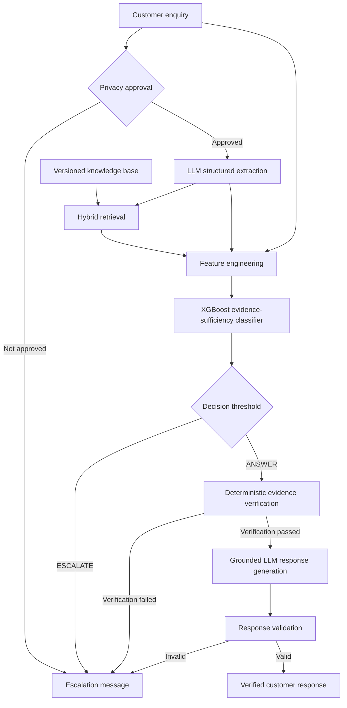
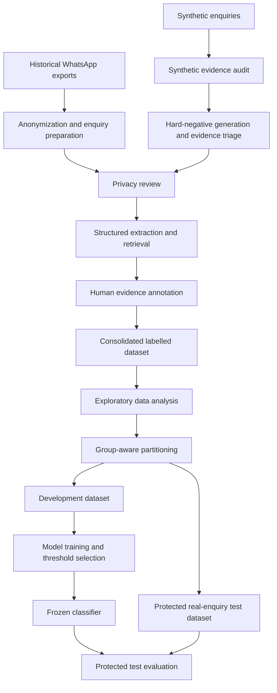
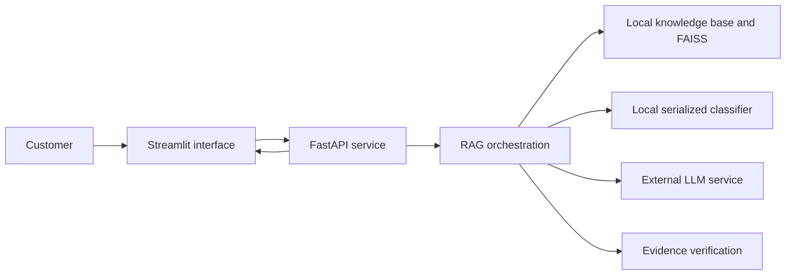

# Development of a Retrieval-Augmented Customer Support Framework with Intelligent Escalation

## A Diagnostic Laboratory Case Study

MSc Applied Machine Learning  
Strathmore University  
DSA 8401 Capstone Project  
November 2026

## Quick Start

The frozen trained classifier and versioned laboratory
knowledge base are included in this private repository.

The application can be launched using Docker without
retraining the machine learning model or rebuilding
the knowledge base.

### Prerequisites

- Authorized access to this private GitHub repository.
- Git.
- Docker Desktop with Docker Compose.
- Internet access for the embedding model and LLM service.
- A valid Groq API key.

### 1. Clone the repository

```powershell
git clone https://github.com/Anim565/customer-support-rag.git
cd customer-support-rag
```

### 2. Configure environment variables

```powershell
Copy-Item .env.example .env
```

Open the local .env file and configure your own Groq API key.

API credentials must never be committed to GitHub.

### 3. Verify the deployment configuration

```powershell
docker compose config --quiet
```

### 4. Build and start the application

Ensure Docker Desktop is running, then execute:

```powershell
docker compose up --build -d
```

The first build may take several minutes, depending on
internet connectivity and available computing resources.

The initial backend startup may also require downloading
the sentence-transformer embedding model.

### 5. Check container status

```powershell
docker compose ps
```

Wait until the backend is healthy and the frontend
container is running.

### 6. Open the application

| Component | Address |
|---|---|
| Customer support interface | http://localhost:8501 |
| FastAPI service | http://localhost:8000 |
| Interactive API documentation | http://localhost:8000/docs |
| Backend health check | http://localhost:8000/health |
| Frozen model metadata | http://localhost:8000/metadata |

### 7. Demonstrate the framework

Example enquiries:

| Customer enquiry | Intended demonstration |
|---|---|
| What is the price of lipid profile? | Catalogue-grounded answering |
| What is the price of TSH? | Laboratory test price retrieval |
| Can you arrange a courier to collect my sample? | Operational enquiry escalation |

Actual decisions depend on structured extraction,
retrieval, classifier scoring, evidence verification
and external API availability.

The system may conservatively escalate an otherwise
answerable enquiry.

Use synthetic, non-identifying enquiries for demonstration.

### 8. Monitor application logs

```powershell
docker compose logs --tail 100 backend
docker compose logs --tail 100 frontend
```

### 9. Stop the application

```powershell
docker compose down
```

### Deployment notes

The repository includes the original frozen XGBoost
classifier, decision policy, laboratory catalogue,
FAISS index and knowledge base metadata.

No historical customer conversations or customer-level
training datasets are required for application inference.

External LLM credentials and internet connectivity
remain necessary for complete application operation.

The application is a research prototype intended for
academic assessment. It is not an authenticated
production healthcare service and must not be used to
process identifiable patient information.

---

## 1. Project Overview

This project develops and evaluates a retrieval-augmented
customer support framework for Dr. Kalebi Labs, a diagnostic
laboratory in Kenya.

Diagnostic laboratory customers frequently require information
about available tests, prices, turnaround times, specimen
requirements and patient preparation.

Conventional customer support requires staff to retrieve and
communicate this information manually. General-purpose language
models introduce additional risks when their responses are not
grounded in verified laboratory information.

The proposed framework combines structured language model
extraction, hybrid information retrieval, supervised machine
learning, deterministic evidence verification and grounded
response generation.

Its central objective is not simply to answer customer enquiries,
but to determine when sufficient evidence exists to answer
and when human review is required.

## 2. Research Objectives

1. Develop a structured, versioned laboratory test knowledge base.
2. Implement hybrid retrieval of relevant laboratory information.
3. Develop grounded retrieval-augmented response generation.
4. Develop a supervised evidence-sufficiency classifier for
   intelligent escalation.
5. Integrate and evaluate the framework through a functional
   customer support application.

## 3. Research Problem

A conventional chatbot may generate plausible responses even
when supporting information is incomplete, ambiguous or absent.

In a diagnostic laboratory, incorrect information concerning
test prices, specimen requirements, preparation instructions
or turnaround times can adversely affect customer experience
and laboratory operations.

This project therefore formulates customer support as a
selective answering problem with two possible decisions:

- ANSWER: Sufficient verified catalogue evidence is available.
- ESCALATE: The enquiry requires human review.

The framework prioritizes the avoidance of unsupported answers
over maximizing automated response coverage.

## 4. System Architecture



The system uses two distinct language model components.

The first extracts structured information from the customer
enquiry, including intent, requested tests, requested fields,
ambiguity and contextual dependence.

The second generates a structured response only after the
classifier and deterministic evidence checks permit answering.

The language model does not have unrestricted authority to
generate laboratory information.

## 5. Knowledge Base

The frozen research knowledge base contains 2143 laboratory
catalogue records.

Knowledge base version: 20261116T084302Z

The catalogue includes:

- Test identifiers and names.
- Alternative names and synonyms.
- Prices.
- Turnaround times.
- Specimen requirements.
- Preparation instructions.
- Test descriptions and additional details.

The knowledge base construction pipeline produces:

- catalogue.csv
- documents.jsonl
- catalogue.faiss
- quality_report.json
- quality_issues.csv
- A version manifest.

Missing catalogue information is retained as missing rather
than replaced with invented information.

The deployed framework resolves the active knowledge base
through its version identifier instead of relying on an
original absolute directory path.

## 6. Data Sources and Privacy

The study uses two principal sources of customer enquiries:

1. Historical laboratory customer support enquiries.
2. Synthetic enquiries representing different customer
   information needs and challenging evidence conditions.

Historical WhatsApp group conversations were exported and
processed using Python-based anonymization procedures.

Subsequent preparation included message processing, role
correction, enquiry reconstruction, de-identification,
privacy review and annotation.

Human privacy review was required before approved enquiries
could be submitted to the language model extraction workflow.

The sanitized dataset excludes the original_question field.

The privacy review dataset contained 2714 records, of which
2611 were retained after approval and non-empty text filtering.

| Source | Approved records |
|---|---:|
| Real | 1865 |
| Synthetic | 746 |
| Total | 2611 |

The original synthetic evidence audit included 3000 enquiries
and 500 additional hard-negative examples.

The final annotated research dataset is a selected subset
rather than the entire synthetic evidence audit.

Raw conversations, customer-level datasets and credentials
are excluded from the repository. Only the specifically
reviewed and authorized deployment artifacts are included.

Privacy approval does not constitute a guarantee of complete
anonymity. External processing and artifact distribution
remain subject to appropriate authorization and governance.

## 7. Data Preparation



The diagram represents the methodological workflow rather
than a single fully automated executable pipeline.

The final annotated dataset contains 1217 records.

| Source | ANSWER | ESCALATE | Total |
|---|---:|---:|---:|
| Real | 80 | 837 | 917 |
| Synthetic | 200 | 100 | 300 |
| Total | 280 | 937 | 1217 |

The final group-aware partitioning produces:

| Dataset | ANSWER | ESCALATE | Total |
|---|---:|---:|---:|
| Development real | 55 | 662 | 717 |
| Development synthetic | 200 | 100 | 300 |
| Development total | 255 | 762 | 1017 |
| Protected real test | 25 | 175 | 200 |

Synthetic records are restricted to the development dataset.

The protected evaluation dataset contains only real enquiries.

No record or group overlap was observed between the final
development and protected test datasets.

Targeted sampling and deliberate class allocation mean that
the dataset prevalence should not be interpreted as an
estimate of natural customer enquiry prevalence.

## 8. Hybrid Retrieval

The retrieval framework combines lexical and semantic search.

Lexical retrieval supports exact test names, alternative
names, abbreviations and other catalogue matching signals.

Semantic retrieval supports variation in customer wording
and conceptual similarity.

Dense retrieval uses sentence-transformer embeddings and
a FAISS vector index.

Retrieved candidates provide both contextual evidence and
retrieval diagnostics for the supervised classifier.

Hybrid retrieval is used because semantic similarity does
not necessarily establish exact clinical test identity,
while lexical matching alone may miss customer paraphrases
and alternative expressions.

## 9. Feature Engineering

The classifier experiments compare four feature configurations:

| Configuration | Feature groups |
|---|---|
| A | Word and character TF-IDF features |
| B | Text and retrieval features |
| C | Structured extraction and retrieval features |
| D | Text, structured extraction and retrieval features |

Structured features describe customer intent, requested
information, ambiguity and contextual dependence.

Retrieval features describe candidate availability, retrieval
scores, lexical and semantic matches, evidence completeness
and requested-field coverage.

Text features capture linguistic patterns that may not be
represented by structured extraction alone.

All preprocessing and model fitting must respect the final
development and protected test boundaries.

## 10. Model Development

Three supervised classification algorithms were compared:

- Logistic Regression.
- Support Vector Machine.
- XGBoost.

The experiments compared four feature configurations and
two training strategies:

- Real-only training.
- Real and synthetic augmented training.

This resulted in 24 baseline experimental configurations.

Five-fold development validation was used, with evaluation
on real development enquiries.

Synthetic examples were not included in real validation
folds.

Model selection considered both ranking performance and
the operational requirements of selective answering.

The final classifier was selected using a constrained
decision policy rather than accuracy alone.

## 11. Final Model and Decision Policy

| Property | Selected configuration |
|---|---|
| Algorithm | XGBoost |
| Feature configuration | D |
| Training strategy | Real-only |
| Class weighting | Unweighted |
| Random seed | 42 |
| Decision threshold | 0.7423206567764282 |
| Knowledge base | 20261116T084302Z |

The classifier estimates an ANSWER-class score.

An enquiry is considered for answering only when the
selected decision threshold is satisfied.

The score is treated as a model decision score rather than
a clinically validated or calibrated probability.

Development model selection prioritized:

- ANSWER precision of at least 90%.
- ESCALATE recall of at least 95%.
- A minimum number of predicted ANSWER decisions.

Among qualifying operating points, the policy prioritized
recovering more correctly answerable enquiries.

The selected model and threshold were frozen before
protected test evaluation.

## 12. Classifier Evaluation

### Development out-of-fold performance

| Metric | Result |
|---|---:|
| Real validation enquiries | 717 |
| Accuracy | 94.56% |
| ANSWER precision | 90.00% |
| ANSWER recall | 32.73% |
| ESCALATE recall | 99.70% |
| Macro F1 | 0.7257 |
| ROC AUC | 0.9520 |
| Average precision | 0.6429 |
| Answer coverage | 2.79% |

### Protected test performance

| Metric | Result |
|---|---:|
| Real test enquiries | 200 |
| Accuracy | 89.00% |
| ANSWER precision | 80.00% |
| ANSWER recall | 16.00% |
| ESCALATE recall | 99.43% |
| Macro F1 | 0.6036 |
| ROC AUC | 0.9687 |
| Average precision | 0.7353 |
| Answer coverage | 2.50% |

Protected test confusion matrix:

| Actual class | Predicted ANSWER | Predicted ESCALATE |
|---|---:|---:|
| ANSWER | 4 | 21 |
| ESCALATE | 1 | 174 |

The always-escalate baseline achieved 87.5% accuracy.

Although the selected classifier demonstrated strong ranking
performance and high escalation recall, its protected
ANSWER precision did not meet the predefined 90% target.

Only five protected enquiries were predicted as ANSWER,
resulting in substantial uncertainty in the precision estimate.

The approximate 95% Wilson confidence interval for ANSWER
precision was 37.6% to 96.4%.

The model therefore demonstrates feasibility but does not
establish readiness for autonomous production deployment.

## 13. Deterministic Evidence Verification

The supervised classifier is supplemented by deterministic
evidence checks before response generation.

These checks assess:

- Exact or approved alternative test identity.
- Requested-field availability.
- Candidate ambiguity.
- Specimen and test scope compatibility.
- Validity and uniqueness of requested catalogue values.
- Unsupported, contextual or mixed requests.
- Requests requiring live operational confirmation.

A classifier ANSWER prediction does not guarantee that the
final system will produce an answer.

Evidence verification can override the classifier and
require escalation.

The guardrails were refined following error analysis and
were evaluated separately from the frozen classifier.

Post-evaluation regression checks are not presented as
independent protected test evidence.

## 14. Grounded Response Generation

The response generation component receives verified evidence
only after the decision and evidence verification stages.

It uses structured output with validation against the
verified test codes, requested fields and catalogue values.

Invalid, unsupported or inconsistent generated responses
result in escalation.

Final response formatting uses verified catalogue values
rather than unrestricted generated laboratory claims.

The framework currently provides an escalation message.
It does not implement automated case transfer to a live
customer support agent.

## 15. Integrated Functional Evaluation

The integrated framework was evaluated using 30 synthetic
functional challenge cases, including two cases without
privacy approval.

Of the 28 approved cases, 15 were expected to be answerable
and 13 were expected to require escalation.

| Metric | Result |
|---|---:|
| Total functional cases | 30 |
| Privacy-blocked cases | 2 |
| Authorized cases | 28 |
| Completed classification | 23 |
| Handled technical failures | 5 |
| Final correctly answered cases | 1 |
| Final unsupported answers observed | 0 |
| Authorized final decision accuracy | 50.00% |
| Authorized answer recall | 6.67% |
| Authorized answer coverage | 3.57% |

The five handled technical failures were caused by rate
limits during structured extraction.

Although the framework failed closed, these technical
failures should not be interpreted as successful intelligent
classification.

On the same 23 cases completing classification, the
classifier answered three correctly, while the final
guardrailed framework answered one correctly.

This illustrates the trade-off between conservative
verification and useful response coverage.

The absence of observed unsupported final answers in this
small challenge set is not proof of complete safety.

## 16. Application and Deployment



The research prototype is implemented using:

- Python 3.12.10.
- FastAPI.
- Streamlit.
- Scikit-learn.
- XGBoost.
- FAISS.
- Sentence Transformers.
- Groq language model API.
- Docker and Docker Compose.

The classifier and retrieval components operate locally.

Language model extraction and structured response generation
require an external API service.

Docker separates the backend and frontend into distinct
containers.

Local Docker deployment, frontend connectivity and API smoke
checks were successfully demonstrated.

The prototype is not an authenticated, production-grade
public healthcare service.

## 17. Repository Structure

```text
customer-support-rag/
|-- README.md
|-- AI_USE.md
|-- .gitignore
|-- .gitattributes
|-- .dockerignore
|-- .env.example
|-- Dockerfile
|-- Dockerfile.frontend
|-- docker-compose.yml
|-- requirements-backend.txt
|-- requirements-frontend.txt
|-- requirements-research.txt
|-- requirements-research-lock.txt
|-- api.py
|-- app.py
|-- rag_pipeline.py
|-- kb_paths.py
|-- ranking_v4.py
|-- evidence_features.py
|-- evidence_guardrails.py
|-- response_generator.py
|-- llm_query_extractor_v64.py
|-- exploratory_data_analysis.ipynb
|-- modelling.ipynb
|-- src/
|   +-- data_preparation/
|-- tests/
+-- docs/
```

Additional root-level scripts support catalogue acquisition,
data preparation, annotation, retrieval experimentation,
sampling and evaluation.

The two official research notebooks are:

1. exploratory_data_analysis.ipynb
2. modelling.ipynb

Superseded experiments have been archived locally.

## 18. Installation

Clone the repository:

```bash
git clone https://github.com/Anim565/customer-support-rag.git
cd customer-support-rag
```

Create a Python environment using Python 3.12.10.

Windows PowerShell:

```powershell
python -m venv .venv
.\.venv\Scripts\Activate.ps1
python -m pip install --upgrade pip
python -m pip install -r requirements-research.txt
python -m pip install -r requirements-backend.txt
python -m pip install -r requirements-frontend.txt
python -m pip check
```

The research dependency lock file records the environment
used for the final research implementation.

Backend and frontend dependencies are maintained separately
for containerized deployment.

Create a local environment configuration:

```powershell
Copy-Item .env.example .env
```

Configure the required API credentials in .env.

Never commit API credentials to version control.

## 19. Included Research and Deployment Artifacts

This private repository includes the seven approved frozen
deployment artifacts required to run the research prototype.

Distribution is restricted to authorized academic assessment.

The included artifact layout is:

```text
data/
|-- knowledge_base/
|   |-- current.json
|   +-- versions/
|       +-- 20261116T084302Z/
|           |-- catalogue.csv
|           |-- catalogue.faiss
|           |-- documents.jsonl
|           +-- quality_report.json
+-- private/
    +-- modelling_v1/
        |-- classifier.joblib
        +-- policy.json
```

The repository is self-contained for application inference
and deployment, subject to dependency installation, embedding
model availability and external API configuration.

The examiner does not need to retrain the classifier or
rebuild the knowledge base to demonstrate the application.

All seven deployment artifacts retain their original
SHA-256 fingerprints and have a combined size of
approximately 9.35 MB.

Artifact sizes and SHA-256 fingerprints are recorded in
docs/artifact_manifest.json.

Original customer conversations, customer-level research
datasets, annotation workbooks, extraction caches and API
credentials remain excluded.

Independent reproduction of model training requires authorized
access to the historical research datasets and the documented
human review procedures.

Serialized model files must only be loaded from trusted sources.

The included artifacts must not be redistributed without
appropriate authorization.

## 20. Running the Application

After installing the research, backend and frontend
dependencies and configuring the local API credentials,
the backend can be started using:

```powershell
python -m uvicorn api:app --host 127.0.0.1 --port 8000
```

In a separate activated environment terminal:

```powershell
python -m streamlit run app.py --server.port 8501
```

Alternatively, use Docker:

```powershell
docker compose config --quiet
docker compose build
docker compose up -d
docker compose ps
```

Local endpoints:

- Frontend: http://localhost:8501
- API: http://localhost:8000
- API documentation: http://localhost:8000/docs
- Health: http://localhost:8000/health
- Metadata: http://localhost:8000/metadata

Stop containers with:

```powershell
docker compose down
```

The initial startup may require downloading the embedding
model. External language model access requires valid API
credentials and available provider capacity.

## 21. API Interface

The framework exposes:

| Method | Endpoint | Purpose |
|---|---|---|
| GET | / | Service information |
| GET | /health | Model readiness |
| GET | /metadata | Frozen model configuration |
| POST | /chat | Process a customer enquiry |

Example request:

```json
{
  "question": "What is the price of lipid profile?",
  "privacy_approved": true
}
```

The response includes the final decision, customer response,
knowledge base version, processing time and service status.

The service distinguishes processed requests, privacy-blocked
requests and detected degraded processing conditions.

Privacy approval must be supplied explicitly.

Users must not submit identifiable patient information
through this research prototype.

## 22. Reproducing the Research

### Catalogue acquisition

Install the required Playwright browser if needed:

```powershell
python -m playwright install chromium
```

Acquire a catalogue snapshot:

```powershell
python daily_catalogue.py --page "<AUTHORIZED_CATALOGUE_PAGE_URL>"
```

Build the knowledge base from the appropriate snapshot:

```powershell
python build_knowledge_base.py --input "<SNAPSHOT_PATH>"
```

For exact research evaluation, retain the historical frozen
knowledge base rather than substituting a current catalogue.

### Historical enquiry preparation

The repository includes scripts and modules for:

- WhatsApp parsing and preprocessing.
- Enquiry extraction and reconstruction.
- Message role correction.
- De-identification.
- Privacy review workbook preparation.
- Structured extraction and candidate retrieval.
- Annotation workbook preparation.
- Targeted annotation sampling.

The historical preparation workflows require authorized data
and human review.

They should not be executed indiscriminately against
identifiable customer conversations.

### Reproduce the privacy-approved dataset

```powershell
python sanitize_privacy_review.py --input data/private/privacy_review.xlsx --output data/private/reproduced/privacy_review_sanitized.xlsx
```

### Reproduce the combined synthetic evidence audit

```powershell
python merge_synthetic_audits.py --output data/private/reproduced/combined_v4_audit.csv
```

### Reproduce the master dataset export

```powershell
python export_master_dataset.py --input data/private/final_dataset_v2_backup/complete_labelled_dataset.csv --output data/private/reproduced/master_annotated_dataset.csv
```

The required existing intermediate source artifacts must be
available before executing these commands.

### Exploratory data analysis and partitioning

Open exploratory_data_analysis.ipynb with the project
Python environment.

The notebook analyzes the catalogue, approved enquiries
and master annotated dataset and produces the final
group-aware development and protected test partitions.

### Model development

Open modelling.ipynb with the project Python environment.

The notebook implements feature preparation, model
comparison, tuning, threshold selection, model fitting,
serialization and evaluation.

Use the frozen historical inputs and avoid overwriting
the original model or evaluation artifacts during
reproduction experiments.

### Functional evaluation

The integrated evaluation utility is evaluate_system.py.

Its available stages include:

```powershell
python evaluate_system.py --help
```

The historical functional test cases and manual review
results should be preserved. Re-execution may produce
different outcomes because of external API availability
and language model variability.

## 23. Reproducibility and Software Validation

Three previously interactive data preparation procedures
were formalized into reusable scripts and validated.

| Artifact | Rows | Columns | Validation |
|---|---:|---:|---|
| Sanitized privacy review dataset | 2611 | 5 | Identical content |
| Master annotated dataset | 1217 | 24 | Identical content |
| Combined synthetic evidence audit | 3500 | 28 | Identical content |

Validation compared original and regenerated data using
pandas.testing.assert_frame_equal.

Additional software checks included:

- Syntax validation of 36 root-level Python scripts,
  including the three newly formalized scripts.
- Successful core application imports.
- Sixteen passing existing unit tests.
- Local API integration and Docker smoke checks.
- Successful knowledge base relocation testing.

The existing unit tests cover specific data preparation
components and are not an exhaustive test of the entire
integrated application.

To execute the available unit tests:

```powershell
python -m pytest -q
```

Full independent end-to-end reproduction from original raw
data has not been established.

The original combined enquiry workbook creation, initial
synthetic enquiry generation, original annotation batch
consolidation and some historical selection procedures
have not been fully reconstructed as standalone executable
steps.

Exact reproduction also depends on authorized data access,
human review, dependency versions, frozen artifacts and
external language model behaviour.

Further validation details are provided in
docs/reproducibility_validation.md.

## 24. Limitations

1. Low automated answer coverage despite strong classifier
   ranking performance.
2. Protected test ANSWER precision below the predefined
   acceptance target.
3. Limited statistical certainty from a small number of
   predicted ANSWER cases.
4. Class imbalance and targeted sampling.
5. Dependence on catalogue accuracy and completeness.
6. Variability in structured language model extraction.
7. Sensitivity to customer paraphrasing and exact test
   identification.
8. External language model rate limits and availability.
9. Conservative guardrails that can reject valid answers.
10. Human annotation without independently established
    inter-annotator agreement.
11. Restricted data and artifact distribution.
12. Incomplete reconstruction of some historical data
    preparation steps.
13. No live human escalation integration or production
    authentication mechanism.

## 25. Future Work

Future development should prioritize:

- Larger and independently annotated real-enquiry datasets.
- Improved exact test identity resolution.
- Better handling of abbreviations and paraphrasing.
- Evaluation of score calibration and selective risk.
- Improved answer coverage without compromising precision.
- More robust evidence verification.
- External language model failure handling.
- Independent prospective evaluation.
- Authorized human escalation integration.
- Production security, monitoring and governance.

## 26. Conclusion

The project demonstrates the feasibility of integrating
retrieval-augmented customer support with supervised
evidence-sufficiency classification and deterministic
verification in a diagnostic laboratory setting.

The framework achieved high escalation recall and strong
classifier ranking performance, but its answer coverage
and protected ANSWER precision remain insufficient for
autonomous production use.

The implemented prototype provides a foundation for further
research into reliable, evidence-grounded and selectively
automated laboratory customer support.

## 27. Responsible Use and AI Disclosure

This application is a research prototype and does not
provide medical advice, diagnosis or clinical interpretation.

Customer-level research data and sensitive derived
artifacts must be handled under appropriate authorization.

The use of AI assistance during project development is
documented separately in AI_USE.md.
